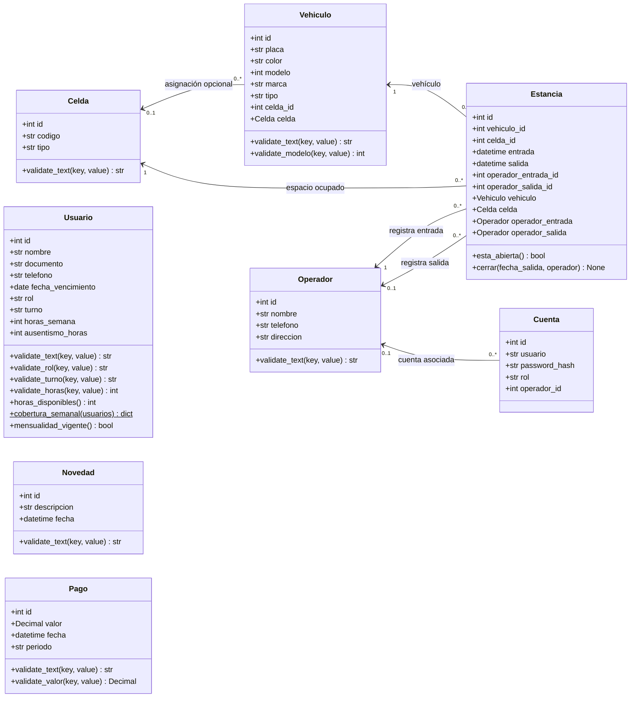

# Diagrama de clases del backend

El diagrama representa las entidades SQLAlchemy definidas en `backend/app/models.py` y sus relaciones por claves foráneas. Las clases `*Crear`, `*Actualizar` y `*Respuesta` de `backend/app/schemas/` son contratos de la API y no entidades persistentes, por lo que no se incluyen.

## Notas

- `Vehiculo.celda_id` admite `NULL`; cada vehículo tiene cero o una celda asignada. La restricción de estancia abierta evita asignar simultáneamente la misma celda abierta a varias estancias.
- Toda estancia referencia un vehículo, una celda y un operador de entrada. El operador de salida es opcional y se establece al cerrar la estancia.
- `Cuenta.operador_id` es una clave foránea opcional. El modelo no declara una relación ORM ni una restricción de unicidad para ese campo.
- `Usuario`, `Pago` y `Novedad` no tienen relaciones declaradas con otras entidades en el modelo actual.
- Las validaciones del diagrama son métodos ORM abreviados; los atributos opcionales o anulables corresponden a columnas que aceptan `NULL`.
